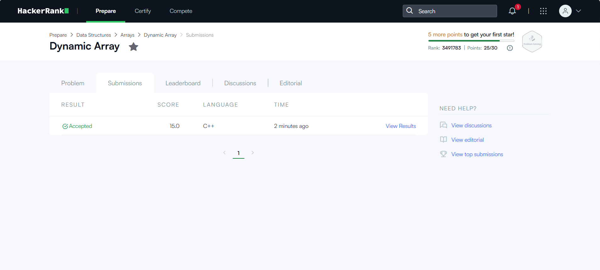

# HackerRank 3rd-Semester Problem-Solving Portfolio

**Student:** Abhik · **SRN:** R25EF003 · REVA University, School of CSE
**HackerRank profile:** https://www.hackerrank.com/profile/YOUR_HACKERRANK_USERNAME
**Language:** C++17

This repository holds my solutions to the five mandatory HackerRank problems for
Studio Activity 8. Each solution passes all HackerRank test cases and meets the
target time and space complexity. Every folder has a commented `solution.cpp`
explaining the problem, the approach and its complexity.

## Repository structure

```
HackerRank-3rdSem-Portfolio/
├── README.md
├── 01-Diagonal-Difference/solution.cpp
├── 02-Dynamic-Array/solution.cpp
├── 03-Time-Conversion/solution.cpp
├── 04-Compare-the-Triplets/solution.cpp
├── 05-Sparse-Arrays/solution.cpp
└── screenshots/            # Accepted submissions + badge evidence
```

## Complexity summary

| # | Problem | Category | Time | Space | Status |
|---|---------|----------|------|-------|--------|
| 1 | [Diagonal Difference](01-Diagonal-Difference/solution.cpp) | 2D Arrays | O(N) diagonal work* | O(1) | ✅ Accepted |
| 2 | [Dynamic Array](02-Dynamic-Array/solution.cpp) | Vectors | O(N + Q) | O(N + Q)** | ✅ Accepted |
| 3 | [Time Conversion](03-Time-Conversion/solution.cpp) | Strings | O(1) | O(1) | ✅ Accepted |
| 4 | [Compare the Triplets](04-Compare-the-Triplets/solution.cpp) | Implementation | O(1) | O(1) | ✅ Accepted |
| 5 | [Sparse Arrays](05-Sparse-Arrays/solution.cpp) | Hash Maps | O(N + Q) avg | O(N) | ✅ Accepted |

\* Reading an N×N matrix takes O(N²) by itself; the diagonal computation is O(N) and
the matrix is never stored, so extra space stays O(1).
\** N sequence headers plus up to Q appended values.

## Approach per problem

**1. Diagonal Difference.** Element (i, j) is on the primary diagonal when `j == i`
and on the secondary diagonal when `j == N-1-i`. Both sums are updated while the
input is read, so no matrix is stored. Output is `|primary − secondary|`.

**2. Dynamic Array.** A `vector<vector<int>>` holds the N sequences. Each query
computes `idx = (x XOR lastAnswer) % N`; type 1 appends `y` (amortised O(1)),
type 2 reads `seq[idx][y % size]` into `lastAnswer` (O(1)).

**3. Time Conversion.** Only the hour changes. `12 AM → 00`, `12 PM → 12`, any
other PM hour gets +12. Minutes and seconds are copied as they are.

**4. Compare the Triplets.** Compare the two ratings at each of the three
positions and award a point to whoever is higher; ties give nothing.

**5. Sparse Arrays.** The naive approach scans all N strings for every query,
which is O(N·Q). Building an `unordered_map<string,int>` frequency table once
makes each query a single average-O(1) lookup, giving O(N + Q).

## Accepted submissions

| Problem | Evidence |
|---------|----------|
| Diagonal Difference |  |
| Dynamic Array |  |
| Time Conversion |  |
| Compare the Triplets |  |
| Sparse Arrays |  |

## Badges


3-Star badge in Problem Solving / C++ — see profile link above.

## Running locally

```bash
g++ -std=c++17 -O2 -o sol 01-Diagonal-Difference/solution.cpp
echo -e "3\n11 2 4\n4 5 6\n10 8 -12" | ./sol    # prints 15
```
